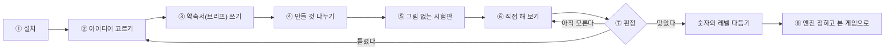

# AI Agent Studio

AI 에이전트(Claude Code, Codex)와 게임을 기획할 때 쓰는 스킬 열여섯 개와 도구 묶음이다.

에이전트는 그럴듯한 숫자를 지어내고, 해 보지도 않고 "재미있을 겁니다"라고 말하고, 만들다 보면 처음 정한 범위를 넘긴다. 이 스킬들은 아이디어, 숫자, 레벨, 플레이 결과를 파일로 적게 하고, 그 파일을 계산기와 검사기로 확인해서 이런 일을 막는다.

**처음이면 여기부터:**

- [쉬운 안내](docs/guide.md): 무엇을 막는지, 스킬마다 쉬운 설명, 꼭 알아 둘 말, 처음 따라 하기
- [그림으로 보는 사용 순서](docs/walkthrough.html): 단계마다 그림 한 장. 저장소를 받아 브라우저로 연다

## 큰 흐름



- **고르는 것, 기준을 정하는 것, 플레이하는 것, 판정을 확정하는 것은 사람이 한다.** 에이전트는 초안을 쓰고 묻는다.
- 숫자에는 출처를 붙인다: `[가정]` 일단 정한 값, `[계산: 출처]` 도구로 낸 값, `[측정: 출처]` 플레이 기록에서 잰 값, `[결정: 누가 날짜]` 사람이 정한 기준. `[계산]`과 `[측정]`은 출처를 꼭 적는다. `[가정]`이 남아 있으면 "확정"이라고 말하지 못한다. 정확한 규칙은 [numeric-provenance의 태그](skills/numeric-provenance/SKILL.md#태그).
- 재미는 계산하지 않는다. 사람이 직접 해 본 기록으로만 판정한다.

새로 시작하는 게임도, 이미 만들고 있는 게임도 쓸 수 있다. 이미 만든 게임은 아이디어 후보를 만들지 않고 지금 게임을 약속서로 적는 데서 시작한다. 특정 장르를 전제하지 않고, 데이터는 JSON/CSV라 Godot·Unity·Unreal·Roblox·웹 어디에도 묶이지 않는다.

## 설치

**게임 프로젝트 폴더에서** 실행한다. 필요한 것은 [Node.js](https://nodejs.org/)(설치할 때만)와 Python 3.9 이상(추가 패키지 없음)이다. 스킬을 모두 설치한다. 공용 도구 `studio-data`가 빠지면 다른 스킬의 검사와 뷰어가 동작하지 않는다.

**1. 스킬 넣기.** 쓰는 에이전트에 맞는 명령 하나만 실행한다.

Claude Code:

```bash
npx skills add silbaram/ai-agent-studio --skill '*' --agent claude-code --copy
```

Codex:

```bash
npx skills add silbaram/ai-agent-studio --skill '*' --agent codex --copy
```

**2. 판정 에이전트와 자동 검사 넣기 (Claude Code만).** 스킬을 다시 설치한 뒤에도 다시 실행한다.

```bash
python3 .claude/skills/studio-data/scripts/studio.py setup claude .
```

이 명령이 `.claude/agents/`에 판정 에이전트(`studio-judge`)를 넣고, `.claude/settings.json`에 다음 훅을 넣는다.

- `design/`·`data/`의 파일을 고칠 때마다 검사를 돌린다.
- 판정 에이전트가 파일을 쓰지 못하게 막는다.
- OpenSpec과 시스템 설계를 함께 쓰는 프로젝트에서 범위 검사에 오류가 있으면 게임 파일 편집을 막고, 범위를 넓히는 편집은 사용자에게 묻는다.
- 대화를 새로 열거나 줄이면 앞서 보인 경고 목록을 비워 다음 검사에서 다시 다 보인다.

사용자의 다른 훅과 설정은 그대로 둔다. 자세한 내용은 [studio-data의 Claude Code 연결](skills/studio-data/SKILL.md#claude-code-연결).

**3. 뷰어 열기.** 모든 데이터를 브라우저 탭으로 보는 읽기 전용 화면이다. 데이터 파일이 아직 없어도 열리고, 파일이 생기거나 바뀌면 저절로 갱신된다.

```bash
python3 .claude/skills/studio-data/scripts/studio.py view .
```

| 에이전트 | 설치 위치 | 명령의 경로 |
| --- | --- | --- |
| Claude Code | `.claude/skills/<스킬 이름>/` | `.claude/skills/studio-data/scripts/studio.py` |
| Codex | `.agents/skills/<스킬 이름>/` | `.agents/skills/studio-data/scripts/studio.py` |

- **갱신은 같은 설치 명령을 다시 실행한다.** `--copy`는 독립 사본이라 이 저장소가 바뀌어도 설치본은 저절로 바뀌지 않는다. 다시 설치하면 덮어쓰므로 설치본을 직접 고치지 않는다.
- 받아 둔 이 저장소(작업 중인 브랜치 등)로 설치하려면 `silbaram/ai-agent-studio` 대신 그 폴더 경로를 쓴다.
- Node.js 없이 설치하려면 `skills/` 안의 열여섯 폴더를 위 표의 설치 위치로 그대로 복사한다.
- Codex에는 판정 에이전트와 훅이 없다. 검사(`check`)와 범위 검사(`scope`)를 직접 돌리고, 판정도 같은 절차를 에이전트가 따른다. 이때는 만드는 쪽과 판정하는 쪽이 나뉘지 않는다.

### Windows에서 쓸 때 (PowerShell과 WSL)

어느 터미널인지에 따라 명령이 다르다. 프롬프트가 `PS C:\...>`이면 PowerShell, `사용자@PC이름:/mnt/c/...$`이면 WSL(Windows 안의 리눅스)이다.

| | PowerShell | WSL |
| --- | --- | --- |
| Python 실행 | `py` | `python3` |
| 경로 구분자 | `\` (`/`도 대체로 된다) | `/`만 |
| Python이 없을 때 | [python.org](https://www.python.org/downloads/)에서 설치 | `sudo apt install python3` |
| 뷰어 열기 | 브라우저가 저절로 열린다 | `--no-browser`로 켜고 Windows 브라우저에서 `http://localhost:8765/`를 연다 |

PowerShell:

```bash
py .claude\skills\studio-data\scripts\studio.py view .
```

WSL:

```bash
python3 .claude/skills/studio-data/scripts/studio.py view . --no-browser
```

- 설치와 실행은 같은 쪽(PowerShell 또는 WSL)에서 한다. 같은 폴더라도 PowerShell에서는 `C:\Users\...`, WSL에서는 `/mnt/c/Users/...`로 보인다.
- 브라우저에서 열리지 않으면 `--port`로 다른 포트를 지정해 본다.
- 에이전트를 WSL에서 실행했다면 에이전트도 `python3`과 `/` 경로를 쓴다.

## 이렇게 말하면 된다

에이전트는 설치된 스킬의 설명을 보고 맞는 것을 스스로 고를 수 있다(Claude Code와 Codex에서 확인했다. [확인 범위](skills/studio-data/SKILL.md#실행)). 늘 고른다는 보장은 없으니, 특정 스킬을 쓰게 하려면 문장에 `$스킬이름`을 넣는다.

아이디어를 찾을 때:

```text
$concept-exploration으로 혼자 만드는, 한 판이 짧은 카드 게임 아이디어를 찾아줘.
재미 점수로 고르지 말고 구조가 다른 후보를 비교표로 보여줘.
```

이미 만들고 있는 게임이면:

```text
$concept-exploration으로 지금 만들고 있는 이 게임을 정리해줘. 새 후보는 만들지 말고,
게임 코드에 흩어진 수치를 데이터 파일로 옮기는 방법도 제안해줘.
```

플레이한 뒤:

```text
$playtest-verdict로 오늘 플레이한 것을 기록해줘. 나, 친구 2명이 각각 3판씩 했고 빌드는 지금 커밋이야.
관찰값은 내가 말한 것과 로그 파일에 있는 것만 적고, 판정은 studio-judge에게 맡겨서 제안만 보여줘.
```

<details>
<summary>숫자와 레벨을 다룰 때의 예시 더 보기</summary>

```text
$numeric-provenance로 design/economy.md의 모든 수치에 출처 태그를 달아줘.
에이전트가 제안한 값은 가정으로 두고, 확정 판정은 하지 마.
```

```text
$combat-balance로 구역마다 기준 장비를 정하고, 일반·정예·보스를 몇 대에 잡고 몇 대 맞으면 죽는지 표로 보여줘.
방어 공식은 이 게임에 맞는 형태를 추천하고 이유를 말해줘. 목표 범위를 벗어난 칸만 따로 짚어줘.
```

```text
$stat-budget으로 아이템 티어별 예산 곡선을 지금 데이터에 맞춰 제안하고, 곡선을 벗어난 아이템을 알려줘.
그다음 티어 3 공속 무기 초안을 하나 만들어서 제안 상태로 넣어줘.
```

```text
$crafting-balance로 무기 강화 +1~+5를 설계해줘. +4부터는 실패하면 한 단계 떨어지게 하고, 단계별 기대 비용 표를 보여줘.
```

```text
$economy-flow로 구역마다 평범하게 깼을 때의 골드 수입을 정리하고, 철검 구입과 무기 +3 강화를 언제 할 수 있는지 보여줘.
```

```text
$level-design으로 구역 1을 방 순서로 구성해줘. 평범한 방의 위협도를 기준으로 예산 곡선을 제안하고,
예산을 벗어난 방과 재화 흐름의 처치 수와 어긋나는 적을 짚어줘.
```

```text
$run-growth로 레벨업 선택지 6개와 빌드 3개(공격 위주, 버티기, 고르게)를 정의하고,
구역마다 빌드별로 정예와 보스를 몇 대에 잡는지 비교해줘.
```

```text
$progression-economy로 2구역에 나올 정예 적을 하나 추가해줘.
제안 상태로 넣고 검사 경고가 있으면 알려줘. 바뀐 행만 보여줘.
```

</details>

## 스킬 16개

| 이럴 때 | 스킬 | 하는 일 |
| --- | --- | --- |
| 아이디어만 있다. 또는 만들고 있는 게임을 정리하고 싶다 | [concept-exploration](skills/concept-exploration/SKILL.md) | 구조가 다른 후보를 만들고 쉬운 꼼수로 깨 본다. 사람이 고른 안을 약속서(꼭 지킬 것, 가설, 가장 작은 시험판)로 적는다 |
| 직업, 스킬, 카드 같은 내용을 무엇으로 할지 함께 짜고 싶다. 또는 내용 아이디어를 던졌다 | [content-ideas](skills/content-ideas/SKILL.md) | 장르를 조사해 좋은 내용이 지키는 법칙을 출처와 함께 먼저 제안하고, 그 법칙을 따르는 안 두세 벌을 낸다. 함께 다듬은 뒤 필러를 건드리는 주장만 가설로, 새 규칙은 시스템으로, 수치는 데이터로 넘긴다. 절차 문서만 있다 |
| 어떤 시스템이 필요한지 정리하고 싶다 | [system-design](skills/system-design/SKILL.md) | 시스템과 규칙, 의존을 적어 약속서에 잇는다. 이어지지 않는 것, 범위 밖으로 새는 것, 만드는 순서를 알려 준다 |
| 개발 작업이 범위를 넘지 않게 하고 싶다 | [scope-guard](skills/scope-guard/SKILL.md) | OpenSpec 작업을 약속서와 시스템에 잇고, 범위 밖 작업과 낡은 명세를 찾는다. 범위를 넓히는 편집은 사용자에게 묻는다 |
| 숫자가 어디서 왔는지 표시하고 싶다 | [numeric-provenance](skills/numeric-provenance/SKILL.md) | 숫자에 `[가정]` / `[계산]` / `[측정]` / `[결정]`을 붙이고, 확정 전에 남은 가정을 검사한다 |
| 직접 해 본 결과로 가설을 판정하고 싶다 | [playtest-verdict](skills/playtest-verdict/SKILL.md) | 플레이를 기록하고, 읽기 전용 판정 에이전트가 기록만 보고 버팀(맞았다)·틀림·모름을 제안한다. 확정은 사람이 한다 |
| 아이템, 영구 강화, 적을 관리하고 싶다 | [progression-economy](skills/progression-economy/SKILL.md) | 데이터를 한 곳에 모아 뷰어로 보인다. 위 티어가 더 약한 곳, 다른 아이템보다 모든 면에서 못한 아이템(완전 열위), 드랍 천장, 끊긴 강화 사슬, 적 위협도의 진행을 검사한다. 메타 성장 시뮬레이션 |
| 이 장비로 이 적을 몇 대에 잡는지 알고 싶다 | [combat-balance](skills/combat-balance/SKILL.md) | 하나의 스탯과 방어 공식으로 단계·적마다 처치·버팀 타수와 시간을 계산하고, 목표를 벗어난 칸을 찾는다 |
| 레벨업 선택지와 빌드가 고른지 보고 싶다 | [run-growth](skills/run-growth/SKILL.md) | 빌드마다 얻는 스탯을 시뮬레이션해 전투 계산에 더하고, 어디서나 밀리는 빌드를 찾는다 |
| 티어별 아이템이 너무 세거나 약한지 보고 싶다 | [stat-budget](skills/stat-budget/SKILL.md) | 예산 곡선으로 넘침·모자람을 찾고, 새 아이템·적의 초안을 만든다 |
| 강화와 합성을 설계하고 싶다 | [crafting-balance](skills/crafting-balance/SKILL.md) | 단계별 기대 비용, 합성의 손익, 원하는 결과까지 기대 횟수, 아이템이 불어나는 고리를 계산한다 |
| 돈이 언제 모이고 무엇을 언제 살 수 있는지 보고 싶다 | [economy-flow](skills/economy-flow/SKILL.md) | 단계별 수입과 구매 계획을 이어 구매 시점과 판 끝에 남는 돈을 계산한다 |
| 방, 웨이브, 쉬는 곳을 배치하고 싶다 | [level-design](skills/level-design/SKILL.md) | 조우의 세기를 예산과 견주고, 쉬는 곳 사이의 부담을 보고, 그림 없이 확인할 항목을 플레이 기록과 잇는다 |
| 가설이 버텨서 엔진을 정하고 본 게임으로 넘어가고 싶다 | [production-handoff](skills/production-handoff/SKILL.md) | 넘어갈 준비를 확인하고, 엔진을 필수 조건과 작은 시험으로 고르게 하고, 시험판을 버릴지 키울지 정하고, 본 게임 빌드에서 가설을 작은 표본으로 다시 확인한다. 절차 문서만 있고 검사기는 없다 |
| 본 게임 화면을 만들기 전에 그림 쪽에 넘길 것을 정리하고 싶다 | [art-handoff](skills/art-handoff/SKILL.md) | 플레이어가 화면에서 구분해야 하는 것을 가설의 말과 규칙에서 모아 기대는 가설과 잇고, 그릴 것을 데이터 id에서 옮긴다. 그림 방향을 다시 확인 전에 정할지 뒤에 정할지 사용자가 정한다. 그림체와 색은 정하지 않는다. 절차 문서만 있다 |
| 본 게임을 출시까지 만들고 싶다 | [production-milestones](skills/production-milestones/SKILL.md) | 알파(기능 완료), 콘텐츠 늘리기, 베타(콘텐츠 동결과 숫자 다듬기), 출시 후보 게이트로 나눈다. 버팀 판정에 게임 데이터 지문을 남겨 데이터가 바뀌면 게이트가 막고, 같은 시드 봇 회귀를 보고 사람이 다시 플레이할지 이어 갈지 사용자가 정한다 |
| (모든 스킬이 함께 쓴다) | [studio-data](skills/studio-data/SKILL.md) | 공용 도구 `studio.py`: 검사(`check`), 뷰어(`view`), 시뮬레이션(`simulate`), 기록 보정(`calibrate`), 출처 검사(`provenance`), 범위 검사(`scope`), Claude Code 연결(`setup`) |

## 견본 프로젝트로 도구 해 보기

이 저장소를 받은 폴더에서 견본 프로젝트로 바로 해 볼 수 있다. 게임 프로젝트에 설치했다면 경로 앞부분을 설치 위치(`.claude/skills/...` 또는 `.agents/skills/...`)로 바꾼다. 스킬 문서(SKILL.md)의 명령은 Claude Code 설치 기준으로 적혀 있다.

```bash
python3 skills/studio-data/scripts/studio.py view skills/studio-data/assets/sample-project
python3 skills/studio-data/scripts/studio.py check skills/studio-data/assets/sample-project --table
python3 skills/studio-data/scripts/studio.py simulate skills/studio-data/assets/sample-project/data/meta.json
python3 skills/studio-data/scripts/studio.py simulate skills/studio-data/assets/sample-project/data/meta_combat.json
python3 skills/studio-data/scripts/studio.py calibrate skills/studio-data/assets/sample-project/data/meta_combat.json
python3 skills/studio-data/scripts/studio.py provenance docs/guide.md
```

- `view`는 컨셉·시스템 설계·아이템·영구 강화·적·전투 계산·판 안 성장·스탯 예산·강화·합성·재화 흐름·레벨 구성과 플레이 기록을 탭으로 보여 준다. 문서를 따로 만들지 않으니 맞출 것이 없다. Python 없이 `skills/studio-data/assets/viewer.html`을 열어 '불러오기'로 볼 수도 있지만, 그때는 검사와 계산 없이 원본 값만 보인다.
- `provenance`는 md 문서의 숫자 출처 표시를 검사한다. 견본 프로젝트에는 md 문서가 없어서 이 저장소의 쉬운 안내로 해 본다.
- 확정 판정 직전에는 `check`와 `provenance`에 `--fail-on-assumed`를 붙인다. 가정인 숫자가 하나라도 남으면 실패한다.
- 시뮬레이션 결과는 가정 아래의 계산값이다. 실제 난이도나 재미를 판정하지 않는다.

## 지금 상태

| 층 | 맡는 곳 |
| --- | --- |
| 개발 작업 관리 (기획 → 설계 → 작업 → 구현 → 검증) | [OpenSpec](https://github.com/Fission-AI/OpenSpec) (따로 설치). `scope-guard`로 이 저장소에 잇는다 |
| 게임 설계 (아이디어·시스템·레벨·아이템·경제·밸런스·재미 검증) | **이 저장소** |
| 그래픽 (도트·메시·VFX) | [game-art-skills](https://github.com/silbaram/game-art-skills). 이 저장소의 `art-handoff`가 넘길 것을 정리하고, 그쪽 `art-direction`이 그림 방향과 움직임을, `asset-sourcing`이 그릴 것의 출처와 권리를, `art-integration`이 그것을 게임 화면에 넣고 규칙 그대로인지와 뜻마다 화면을 확인하는 일을 맡는다 |

- [설계 문서](docs/architecture.md)의 로드맵 0~6단계를 1차로 마쳤다. 6단계(그래픽 넘기기)는 절차 문서만 있고 검사기는 없다. 덱빌딩 시험 게임의 사본과 실제 프로젝트에서 현장 시험을 했다.
- 세 시험 게임에서 확인했다: 실시간 액션 로그라이크(새 게임), 턴제 택틱스(이미 만든 게임), 덱빌딩 카드 게임(새 게임).
- Claude Code와 Codex를 리눅스(WSL)에서 실제 세션으로 확인했다. Windows PowerShell은 아직 실제로 돌려 보지 않았다([확인 범위](skills/studio-data/SKILL.md#실행)).
- 엔진 고르기와 본 게임으로 넘어가기는 절차 문서(`production-handoff`)만 있고 검사기는 없다. 덱빌딩 시험 게임에서 본 게임 빌드의 다시 확인과 규칙을 바꿔 되돌아가는 길까지 현장 시험을 했다.
- 본 게임 완성까지(`production-milestones`)는 절차 문서와 판정의 데이터 지문 검사만 있고, 아직 시험 게임으로 돌려 보지 않았다.
- 아직 하지 않는 것: 엔진별 절차(프로젝트 만들기, 빌드), 그래픽과 사운드.

## 개발

```bash
python3 -m unittest discover -s tests
```

저장소 규칙은 [AGENTS.md](AGENTS.md)를 따른다. 원칙과 경위는 [설계 문서](docs/architecture.md)에 있다.

조사 기록:

- [AI 에이전트 프로젝트 수명주기 도구 조사 (2026-11)](docs/research/landscape-2026-11.md)
- [수명주기 뼈대 시험: OpenSpec과 spec-kit (2026-11)](docs/research/lifecycle-trial-2026-11.md)
- [Claude Code Game Studios 분석](docs/research/claude-code-game-studios.md)
- [agentic-gamedev-skills 분석](docs/research/agentic-gamedev-skills.md)
- [방어 공식 조사 (2026-11)](docs/research/defense-formulas-2026-11.md)
- [엔진 고르기와 본 게임으로 넘어가기 조사 (2026-11)](docs/research/engine-and-production-2026-11.md)

참고한 외부 프로젝트와 고지는 [THIRD_PARTY.md](THIRD_PARTY.md)에 있다.

## 라이선스

[MIT 라이선스](LICENSE). 저작권 표시와 라이선스 문장을 남기면 쓰고, 고치고, 다시 배포할 수 있다.
